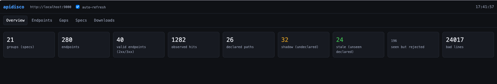
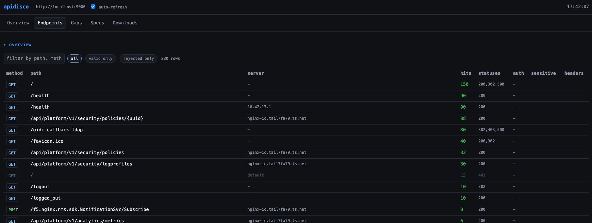
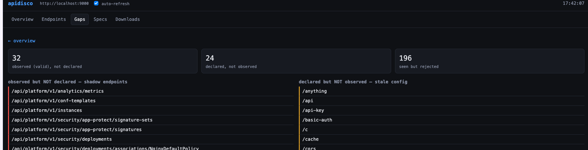
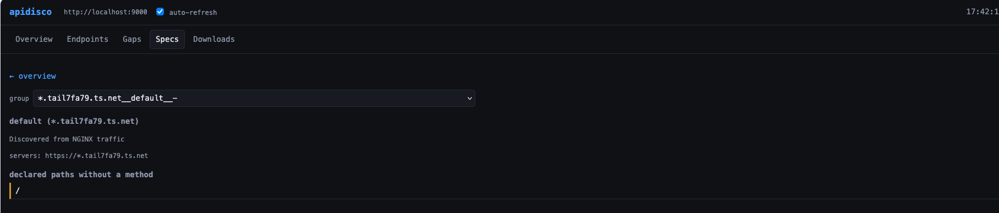
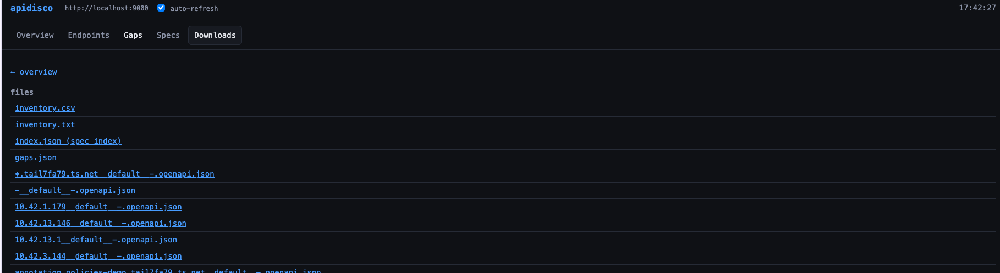

# apidisco_k8s — Kubernetes-only discovery from pod logs

No njs. No NGINX config. No sidecar. It discovers NGINX-ish pods through the Kubernetes API, streams the logs they already write, and turns them into
OpenAPI specs, a CSV/text inventory, and a declared-vs-observed gap report.

```bash
# one-shot over every nginx-ish pod, then exit
python3 k8s/apidisco_k8s.py --kubeconfig ~/.kube/config --once --out ./specs

# follow mode: keep streaming as pods come and go, serve on :9000
python3 k8s/apidisco_k8s.py --kubeconfig ~/.kube/config \
    --namespace prod --name-contains nginx-ic --serve 0.0.0.0:9000
open http://localhost:9000/ui         # web UI
curl -s localhost:9000/inventory.csv
curl -s localhost:9000/gaps
```

## Screenshots

The `--serve` web UI (`/ui`), tab by tab.

**Overview** — headline counts: endpoints observed, spec groups, valid endpoints, observed hits, declared paths, and the three gap buckets (shadow,
stale, rejected), plus bad lines.



**Endpoints** — every observed path with method, vhost/service, hit count and status mix (e.g. `200,302,500`). Filter to `valid only` / `rejected only` or by
free text, and flag routes that are authed, sensitive, or carry headers.



**Gaps** — shadow endpoints (observed but never declared) beside stale declared config (declared but never observed); rejected traffic is counted separately so scanner noise does not drown the real findings.



**Specs** — browse the generated OpenAPI specs group by group: pick a group (e.g. `default (*.tail7fa79.ts.net)`), see its `servers:` entry, whether it came from NGINX traffic or a declaration, and any declared paths that carry no method.



**Downloads** — the generated artifacts: `inventory.csv`, `inventory.txt`, `index.json` (spec index), `gaps.json`, and one OpenAPI spec per server.



## How it picks pods

| Flag | Meaning | Default |
|---|---|---|
| `--namespace` | comma list of namespaces | all namespaces |
| `--pod-selector` | label selector | none |
| `--name-contains` | pod name substring | `nginx` |
| `--container` | which container's logs | `nginx-ingress` / `nginx` / first |
| `--tail` | lines read per pod on attach | `200` |
| `--access-format` | preset: `combined`, `with-host`, `combined-upstream` | `with-host` |
| `--access-pattern` | custom named-group regex (overrides the preset) | – |

It re-lists pods every `--interval` seconds (`30`) so new pods and restarts are picked up; a pod's stream restarts automatically when it ends.

## Log formats seen on a real cluster

| Pod | Emits | Parsed? |
|---|---|---|
| plain `nginx` (e.g. `nginx:alpine`) | access lines on stdout (`combined`, sometimes with extra trailing fields like a literal `http_x_forwarded_for"`) | ✅ |
| a format ending with `"$host"` / `"$server_name"` | access line + vhost | ✅ with `--access-format with-host` (puts the vhost in `server`) |
| NGINX Plus error log (`2026/10/15 .. [info] ..`) | runtime log, not access | skipped (counts toward `bad`) |
| NGF / operator controllers (`{"level":"info","ts":"...","msg":...}`) | JSON app log | skipped (rejected as a record) |
| Ingress controller (`I20261015 .. service.go:29] ..`) | Go controller log | skipped |

If a pod's `log_format` has no `$host`/`$server_name`, every endpoint lands in one
`default` group — add the field to the pod's format, or group with `--group-by api`.

## Line formats

Each line is auto-detected: a body starting with `{` is an apidisco JSON record; otherwise it is parsed as an access line (`--access-pattern` overrides the
regex, e.g. to add `$host $server_name` groups for per-vhost grouping).

## Recommended pod log_format

```nginx
log_format apidisco_access '$remote_addr - $remote_user [$time_local] "$request" '
                           '$status $body_bytes_sent "$http_referer" "$http_user_agent" '
                           '"$host" $upstream_addr $upstream_status $upstream_response_time';
access_log /dev/stdout apidisco_access;
```
Then run with `--access-format combined-upstream` (per-vhost grouping, upstream addr/status, and backend 5xx counted as valid — 502/504 stay NGINX-origin). JSON access logs (`{"request_line":"GET /x HTTP/1.1","status":"200"}`) are detected automatically.

## Declared surface

By default it also reads `Ingress`, Gateway API `HTTPRoute`, and NGINX `VirtualServer`/`VirtualServerRoute` (via the same kubeconfig) and reports
`/gaps`. Disable with `--no-declared`.

## Gaps use valid responses only

`/gaps` counts a path as *observed* only if it returned a **valid** status:

- `--valid-status` (default `2xx,3xx`) — success **and** redirects count.
- a **5xx counts when it came from the backend** (a real endpoint that answered),
  detected from `$upstream_status` / `$upstream_addr`; NGINX-origin 5xx
  (502/504, unreachable upstream) does not. Disable with `--no-backend-errors`.
- anything else (401/403/404, nginx-generated 5xx) lands in `seen_but_rejected`,
  so scanner noise does not drown the real findings.

With plain access logs there is no upstream field, so backend 5xx cannot be credited — add `$upstream_status` to the pod's `log_format` and a `upstatus` group to `--access-pattern` (the njs JSON log records `upstatus` already).

## Notes

- Auth: out-of-cluster kubeconfig (`--kubeconfig`, `--k8s-context`, `--k8s-server`, `--k8s-token`, `--k8s-ca-file`, `--k8s-insecure`). Stdlib only.
- `pods/log` needs `get pods/log` RBAC (usually implied by `pods` read).
- Restarting a stream re-reads the last `--tail` lines, so `x-hits` can be slightly inflated across restarts; use a small `--tail` for follow mode.
- Pods must log access lines to **stdout** (the official `nginx` image symlinks `access.log` to `/dev/stdout`).
